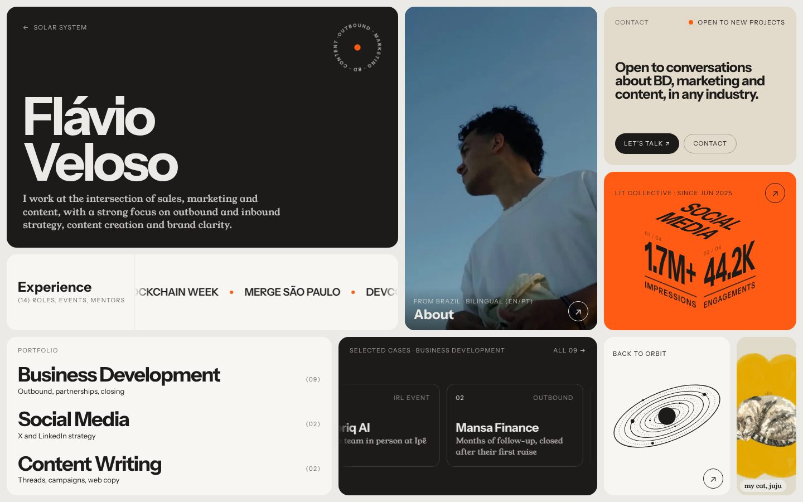
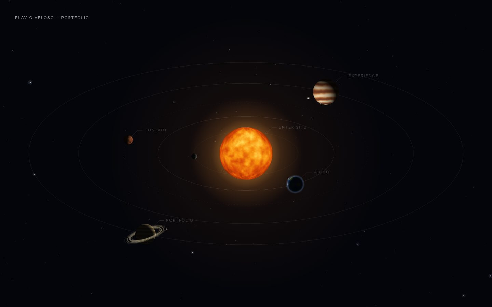
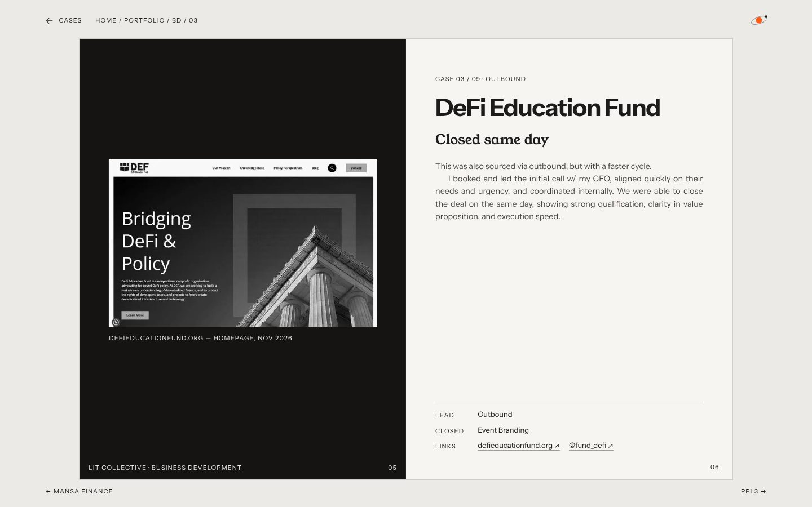
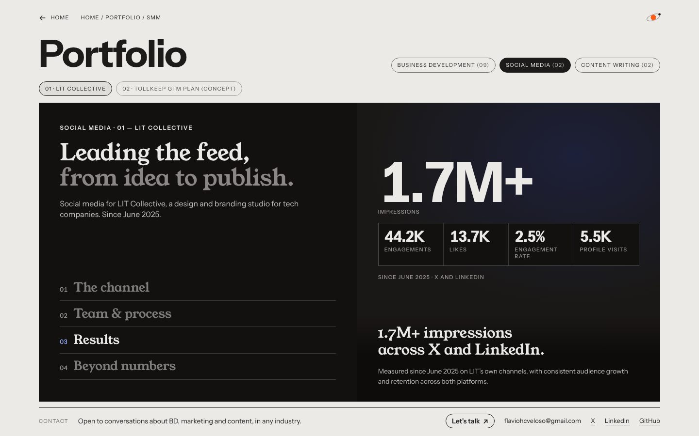
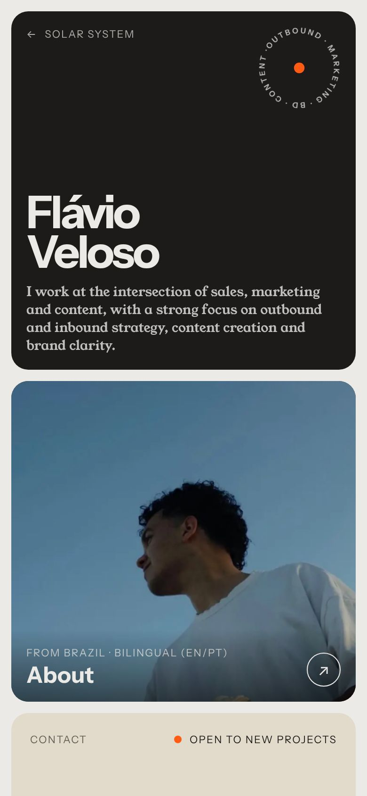

# Flávio Veloso — Portfolio

Personal portfolio of **Flávio Veloso**: business development, outbound, social media and content.
A solar system you can explore, a bento home, and editorial case studies, all in one HTML file.

**Live:** [flavioveloso.vercel.app](https://flavioveloso.vercel.app)



## What's inside

| Section | What it shows |
| --- | --- |
| **Solar system** | An interactive canvas landing: each planet opens a section, the sun opens Home. |
| **Home** | A bento grid with the intro, results, experience, services and selected cases. |
| **Business Development** | 9 real B2B cases, each presented as an open book spread with a capture of the client's live site. |
| **Social Media & Content** | Real work for LIT Collective and a clearly labelled concept case (Tollkeep), told in chapters. |
| **Experience · About · Contact** | Roles, events and education; who I am; and how to reach me. |

<table>
  <tr>
    <td></td>
    <td></td>
  </tr>
  <tr>
    <td></td>
    <td align="center"></td>
  </tr>
</table>

## Built with

- **React 18** (UMD) with **htm**, so there is no build step for the app itself
- **Tailwind CSS 3**, precompiled and inlined
- **Canvas 2D** for the procedural planets and sun, with the textures generated in a Web Worker
- **Instrument Sans** and **Young Serif** from Google Fonts
- Deployed on **Vercel**

## Quality

- Responsive from 320px phones to 3840px screens, including portrait tablets and landscape phones
- Checked at 34 viewport sizes and 27 emulated devices (iPhone, Pixel, Galaxy, iPad, desktop Chrome, Safari and Firefox)
- WCAG AA text contrast, 44px touch targets, keyboard navigation across tabs, and reduced-motion support
- Lab performance on a throttled mobile profile: LCP ≈ 0.7s, CLS 0

## Project structure

```
.
├── index.html   # the whole site: markup, styles, scripts and images
├── docs/        # screenshots used in this README
└── README.md
```

## Run locally

No install needed. Open `index.html` in a browser, or serve the folder:

```bash
npx serve .
```

## Contact

- [LinkedIn](https://www.linkedin.com/in/fl%C3%A1vio-veloso-a29b02254/)
- [X @flaviovlso](https://x.com/flaviovlso)
- flaviohcveloso@gmail.com

---

© 2026 Flávio Veloso. All rights reserved.
